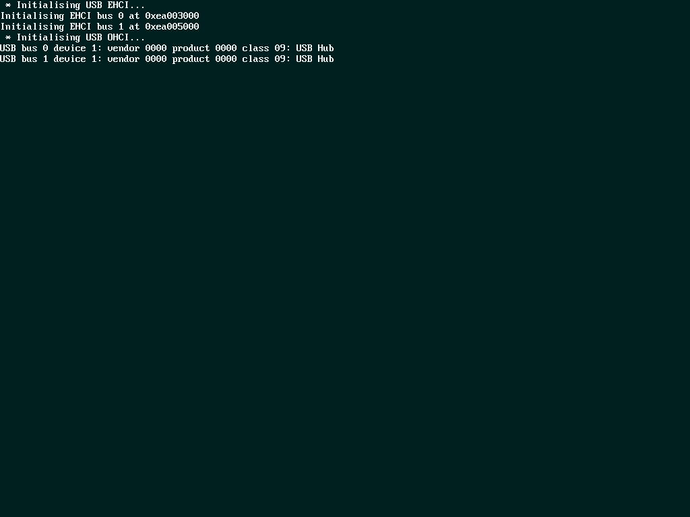

# JPPC — Emulador PowerPC / Xenon en Java

Emulador experimental Java para binarios PowerPC planos y ELF32/ELF64. Incluye CPU, memoria/bus, MMU parcial, caché, UART, SMC, SFCX con lector de imagen NAND Xenon (solo lectura), GPU Xenos parcial, framebuffer tiled y GPU de juguete para demos.

## Requisitos

- JDK 21 o superior.
- Sin dependencias externas.
- NetBeans/Ant usa source/target Java 21.

## Compilar y probar

```sh
./run.sh compile       # compilar en ./out
./run.sh test          # compilar y ejecutar la batería de regresión
ant clean jar          # generar dist/PCP.jar
```

La regresión cubre CPU PPC32, PPC64/FP, AltiVec, framebuffer MMIO, GPU de juguete, LK (shell y RGB bars) y XeLL (SMC/AVPACK, inicialización Xenos, SFCX/NAND, USB, SATA/ATAPI y framebuffer).

## Ejecutar

```sh
./run.sh png
./run.sh lk
./run.sh xell
```

- `./run.sh lk`: ventana de Little Kernel, superficie 1280×720.
- `./run.sh xell`: ventana XeLL, framebuffer del panel dimensionado por `--size` y timebase acelerado para los retardos de firmware. Para el modo VGA 1024×768 del ELF incluido, usa `--size 1024x768`.

Invocación general:

```sh
java -Xmx1g -cp out pcp.PCP archivo [opciones]
```

Opciones: `--elf`, `--load 0xADDR`, `--size WxH`, `--headless`, `--png archivo.png`, `--console-png archivo.png`, `--max N`, `--input "comando\n"`, `--threads N`, `--tb N`, `--bus`, `--trace`, `--watch 0xADDR`, `--fb 0xADDR`, `--vram` y `--nand archivo.bin`.

Captura headless de XeLL:

```sh
java -Xmx1g -cp out pcp.PCP src/pcp/TESTS/xenon.elf \
  --elf --size 1024x768 --tb 1000 --headless --max 300000000 \
  --png out/xell.png --console-png out/xell_uart.png
```

`--png` guarda la imagen que produce el framebuffer Xenos. `--console-png` guarda, por separado, el texto del canal UART como monitor de diagnóstico.

## Capturas

- `capturas/xell_xenos_text_console_1024x768.png`: captura real del framebuffer Xenos; muestra el contenido alcanzado por la ejecución documentada, no el banner final del Auto-Dumper.
- `capturas/xell_uart_1024x768.png`: salida UART del mismo arranque.



- El resto de capturas corresponde a las pruebas de framebuffer y GPU incluidas.

## Estructura

- `src/pcp/cpu/CPU.java`: núcleo PowerPC.
- `src/pcp/cpu/Instruction/`: operaciones y decodificación.
- `src/pcp/system/`: bus, memoria, MMU, caché, excepciones y depurador.
- `src/pcp/gpu/`: framebuffer, Xenos, UART, SMC, SFCX, consola y GPU de juguete.
- `src/pcp/utils/`: ELF y utilidades.
- `src/pcp/TESTS/`: binarios, ELF y fuentes de prueba.
- `tools/`: desensamblador y utilidades de diagnóstico.

## Límites conocidos

No es una Xbox 360 completa. VMX128 sigue sin implementarse. SFCX admite cargar imágenes NAND Xenon de solo lectura y transferir páginas lógicas/físicas; el EDC de 26 bits se calcula y valida como API auxiliar, pero no hay corrección de errores ni remapeo de bloques defectuosos integrado en las lecturas lógicas. Sin `--nand` se conserva el comportamiento de NAND vacía virtual. USB EHCI/OHCI es parcial y presenta dispositivos virtuales mínimos. SATA/ATAPI incluye un canal de sondeo y una unidad DVD virtual sin medio, no almacenamiento masivo ni disco duro. Ethernet, mandos, PIC, PCI y varios periféricos Xenon siguen pendientes. La MMU/BAT e interrupciones también tienen cobertura parcial.

La captura actual confirma escritura visible en el framebuffer Xenos, pero no confirma por sí sola el banner final del Auto-Dumper. El arranque validado por el propietario presenta primero el splash azul de XeLL Reloaded y después transiciona al stage 2 parcheado: 360 Usb Auto-Dumper by blaKCat (Patch 1.035). El ELF permite auditar el stage 2 y su ASCII art CP437. JPPC no declara todavía renderizadas ambas etapas ni alcanzado el banner final; ver `M7.8-REPORT.md`.

## Diagnóstico

- `--trace`: traza de instrucciones.
- `--bus`: accesos a hardware no mapeado y SPRs.
- `--watch 0xADDR`: observa ejecución en una dirección.
- `tools/dis.py`: mini-desensamblador.
- `tools/ProbeTiling.java`: herramienta experimental de tiling.

## Licencia

MIT. Ver `LICENSE`.

```sh
java -Xmx1g -cp dist/PCP.jar pcp.PCP src/pcp/TESTS/fb_demo.bin --headless --png out/fb_demo.png
```

### NAND Xenon real (solo lectura)

Para cargar una extracción RAW small-block de 16 MiB con OOB (0x1080000 bytes):

```sh
java -Xmx1g -cp dist/PCP.jar pcp.PCP src/pcp/TESTS/xenon.elf \\
  --elf --nand /ruta/nand-xenon.bin --size 1024x768 --tb 1000 \\
  --headless --max 300000000 --png out/xell-nand.png
```

`--nand` admite RAW de 17,301,504 bytes (512+16 por página) y datos sin OOB de
16,777,216 bytes. La imagen se abre en modo solo lectura. El cálculo/validación del EDC de 26 bits y la extracción del BlockID small-block están implementados y probados con páginas sintéticas. Aún no se corrigen bits, no se remapean bloques defectuosos y las lecturas lógicas no aplican una traducción de bloques. Las escrituras y borrados son deliberadamente no persistentes.
No usar este milestone como herramienta de flasheo ni como validación de arranque real.

## NAND Xenon: análisis read-only y CB_A

El proyecto incluye `pcp.gpu.XenonNandBootInspector` para inspeccionar dumps RAW Xenon (512+16) y descifrar el cuerpo de CB_A. Ejecuta desde una terminal interactiva para introducir las claves sin incluirlas en la línea de comandos:

```sh
ant jar
java -cp dist/PCP.jar pcp.gpu.XenonNandBootInspector /ruta/nand.raw out/nand-analysis
```

El programa no modifica el dump. Solicita la clave 1BL y la CPU key sin eco; el flujo actual usa la 1BL para CB_A. La CPU key queda reservada para implementar CB_B/KeyVault. El resultado no sustituye la verificación de firma RSA ni el tratamiento de bad blocks. Consulta `M6.2-REPORT.md` para el alcance y los resultados medidos.


## Milestone M7.2 — identidad XeLL y diagnóstico MMIO USB

Audita la identidad de un ELF antes de comparar capturas: `java -cp dist/PCP.jar pcp.utils.XenonElfAudit src/pcp/TESTS/xenon.elf`. El informe incluye tamaño, SHA-256 y presencia de marcadores de build. La ausencia de una cadena literal no descarta arte ASCII/bitmap ni contenido comprimido.

Para trazar exclusivamente el bloque MMIO que detiene el arranque: `--bus-range 0xEA001300:0xEA0013FF` (activa automáticamente `--bus`). La traza no fuerza bits ni sintetiza una respuesta USB. Ver `M7.2-REPORT.md`.

## Resolución 1024x768 (M7.4)

La resolución predeterminada de PCP es ahora 1024x768. Para probar el framebuffer lineal con stride correcto:

```bash
./run.sh demo720
```

El demo original 800x600 se conserva:

```bash
./run.sh demo800
```

`./run.sh xell` usa ventana/framebuffer 1024x768. En ELF Xenon, la superficie se reubica cuando XeLL escribe D1GRPH_PRIMARY_SURFACE_ADDRESS; el renderer conserva la VRAM tiled y el PNG se genera desde esa VRAM, no desde UART.

## Milestone M7.6 — USB MMIO identification

See `M7.6-REPORT.md`. This iteration deliberately does not map `0xEA001300` as a standard OHCI block: a controlled OHCI experiment regressed XeLL to `PC=0x8000BA08`, so the speculative device was removed. The reproducible bus trace and the remaining wait condition are documented in the report. Target display remains 1024x768; framebuffer and UART captures are separate.


## Milestone M7.7 — SATA/ATAPI y SFCX con imagen real

Se añade `XenonSata` en `0xEA001300`, con canal ATA listo para el sondeo, HDD ATA ausente y unidad ATAPI virtual `JPPC Virtual DVD-ROM` sin medio. Se soportan `IDENTIFY PACKET DEVICE`, `INQUIRY` y `REQUEST SENSE`; `TEST UNIT READY` y lecturas devuelven `NOT READY / MEDIUM NOT PRESENT`. El detalle y las limitaciones de integración con XeLL están en `M7.7-REPORT.md`.

Prueba opcional con una NAND RAW propia, sin copiar el dump al proyecto ni al ZIP:

```sh
JPPC_TEST_NAND=/ruta/nand.raw ./tests.sh
```

Esta prueba valida que SFCX puede transferir los datos de la página lógica en `0x4200`. No descifra el KeyVault ni valida sus claves.


## Milestone M7.8 — separación de etapas y diagnóstico SATA/ATAPI

Se documenta la secuencia de dos etapas (splash XeLL Reloaded y stage 2 Auto-Dumper), y se incorpora un desensamblado de las rutinas ATA/ATAPI `0x8A64–0x8F20`. La condición `DRDY` del sondeo inicial y la espera posterior `DRQ` se tratan como estados separados. Las pruebas SATA/ATAPI y SFCX pasan; la ejecución completa de XeLL todavía no está demostrada. Ver `M7.8-REPORT.md`.

## Milestone M8.0 — Xenon Core Compatibility Foundation

M8.0 inicia la consolidación del núcleo con una prueba de regresión específica del bus: alias real-mode de RAM (`0x80000000 + X`), MMIO y endianness big-endian. Ejecuta `./run.sh test` para compilar y lanzar la suite. El alcance, límites técnicos y orden de trabajo están documentados en `M8.0-REPORT.md`.

## M8.1 — SPR, Time Base y Decrementer

M8.1 corrige la lectura de TBL/TBU mediante `mfspr`, conserva los patrones completos de 32 bits escritos en DEC y modela la excepción por underflow del Decrementer. La prueba `pcp.TESTS.XenonTimebaseSelfTest` valida estos comportamientos ejecutando instrucciones sobre la CPU emulada. Consulta `M8.1-REPORT.md` para alcance, límites y resultados de regresión.
## Milestone M8.2

La MMU incorpora traducción BAT clásica para IBAT/DBAT, acceso SPR a BAT y SR, y pruebas deterministas. Ver `M8.2-REPORT.md` para alcance y limitaciones.

## Milestone M8.3 — DSI/ISI exception entry

M8.3 unifica la entrada de excepciones de almacenamiento e instrucción entre MMU y CPU. DSI conserva EA en DAR y distingue escrituras en DSISR; ISI utiliza su vector arquitectónico. La prueba `XenonExceptionSelfTest` valida el estado básico. La MMU sigue siendo parcial y este milestone no demuestra recuperación completa ni arranque de 1BL. Ver `M8.3-REPORT.md`.


## M8.4 — MMU Translation Fault Containment

Ver `M8.4-REPORT.md`. La resolución predeterminada y `run.sh xell` son 1024x768. La regresión de esta configuración ejecuta LK y `xenon.elf`; no invoca `fb_demo` ni `triangle_fixed`. Los fallos de traducción DSI/ISI abortan el acceso en lugar de devolver PA=0.

## M8.5 — TLB lookup e invalidación

Se amplía el VPN a 20 bits y se conectan `tlbie`/`slbia` con invalidaciones reales del TLB software. Véase `M8.5-REPORT.md` para validación y límites. Esta etapa **no declara preparación para 1BL**: SDR1/hash page tables y permisos de PTE siguen pendientes.
